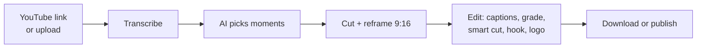

<div align="center">
  

  <h1>ClippyMe · AI Short-Form Studio</h1>

  <p><b>Turn long videos and live streams into publish-ready vertical clips.</b></p>
  <p><a href="https://sifat-jaman-13.github.io/clip-stream-with-ai/">🌐 Official website & live demo</a></p>
  <p>Self-hosted · Docker-first · YouTube · Twitch · Kick</p>

  <p>
    <a href="https://github.com/sifat-jaman-13/clippyme/actions/workflows/ci.yml"></a>
    
    
    
  </p>

  <p>
    <a href="#quick-start">Quick start</a> ·
    <a href="docs/getting-started.md">Getting started</a> ·
    <a href="docs/architecture/overview.md">Architecture</a> ·
    <a href="https://github.com/sifat-jaman-13/clippyme/issues">Issues</a>
  </p>
</div>

ClippyMe is a local-first web app for creators, editors and streamers. Give it
a YouTube link or video file, or point Live Monitor at a channel. It finds the
best moments, creates 9:16 clips with captions, and can publish them to TikTok,
Instagram and YouTube on a schedule you control.

## Highlights

- **Finds the best moments.** The video is transcribed, and Google Gemini
  picks and ranks self-contained clips, with a title, hook and captions for
  each. Clip edges land on sentence boundaries and silences, never mid-word.
- **Frames them for vertical.** Active-speaker tracking keeps the person
  talking in frame, with a camera that stays still within each shot. You can
  switch a clip to subject-centred framing or to a letterboxed full frame at
  any time.
- **Lets you edit before you post.** Colour grade, six animated caption
  styles, silence and filler-word removal, manual transcript trimming (or
  "cut the intro" in plain language), hook text, logo and attribution banner —
  applied when you download or publish, previewed first.
- **Publishes and schedules** through Zernio.
  Provider subscriptions, API quotas and social-platform limits are never
  bypassed by ClippyMe.
- **Runs unattended.** The live monitor follows streams and uploads,
  clips each segment, and publishes the best clips on its own across Kick,
  Twitch and YouTube.
- **Captures Twitch without OAuth for live mode.** Twitch live detection and
  recording use Streamlink; Twitch client credentials are only needed for VOD
  monitoring or backfill.
- **Keeps recordings high quality.** Production H.264 output and normalized
  Twitch recordings use an 8,000 kbps minimum video bitrate.
- **Includes diagnostics.** The dashboard Logs tab shows recent detection,
  capture, processing, publishing and error events with auto-refresh.
- **Stays under your control.** Everything runs on your hardware; clips,
  settings and keys stay in local folders. Long jobs survive restarts and
  resume where they stopped.

## Live Monitor

| Source | Live mode | VOD mode |
|---|---|---|
| YouTube | Detects the active broadcast and captures HLS segments | Watches new long-form uploads |
| Twitch | Uses Streamlink; no OAuth app required | Twitch credentials enable VOD/backfill |
| Kick | Captures the public playback stream | Processes available VODs |

Each segment goes through the same clipping pipeline as a normal job. Twitch
live recordings are normalized with an 8,000 kbps minimum video bitrate, and
the Logs tab shows detection, capture, processing and publishing events.

## How it works



Transcription uses Deepgram by default, ElevenLabs when selected in Settings,
or local Whisper as a fallback. Without a Gemini key, ClippyMe still splits a
video by topic, but clips are not ranked. The [architecture overview](docs/architecture/overview.md)
explains the design.

For unattended workflows, the Live Monitor polls channels, captures fixed
segments, sends them through the normal clipping pipeline, and queues finished
clips for publishing. YouTube live uses the active HLS broadcast; Twitch live
uses Streamlink; Kick uses its public playback stream.

## Quick start

You need Docker Desktop with Compose v2. Then:

```bash
git clone https://github.com/sifat-jaman-13/clippyme.git
cd clippyme
docker compose up -d --build
```

For a first-time setup, copy the example environment file first:

```bash
copy .env.example .env       # Windows
# cp .env.example .env       # macOS/Linux
```

Open <http://localhost:3000>, go to **Settings**, and add the API keys you
have:

| Key | Needed for |
|-----|-----------|
| Gemini | Choosing and ranking moments, titles (recommended) |
| Deepgram or ElevenLabs | Fast cloud transcription (optional; local Whisper otherwise) |
| Zernio | Publishing and scheduling (optional; provider terms and limits apply) |
| Twitch app credentials | Twitch VOD monitoring/backfill; not required for Twitch live capture |

Then paste a video link in **Create**. The [getting started
guide](docs/getting-started.md) walks through the first job, updating, and
where files are stored.

The default Docker ports are `3000` for the dashboard and `8000` for the API.
If port 3000 is unavailable, set `CLIPPYME_FRONTEND_PORT` in `.env`; the
container continues to listen on port 5175 internally. Use the **Logs** tab to
confirm that monitors are detecting streams, Streamlink/FFmpeg are capturing,
jobs are processing, and publishers are accepting posts.


To stop the app:

```bash
docker compose down
```

An NVIDIA GPU is optional
(`docker compose -f docker-compose.yml -f docker-compose.gpu.yml up --build`);
see [deployment](docs/deployment.md) for this and the production frontend.

## Security

By default ClippyMe listens only on `127.0.0.1` and trusts every client on the
local network for its settings. Before opening it to other devices on a
trusted network, set an API token; exposing it to the internet is not
supported. Details:
[deployment → network exposure](docs/deployment.md#network-exposure).
To report a vulnerability, see [SECURITY.md](SECURITY.md).

## Documentation

- [Getting started](docs/getting-started.md) · [Deployment](docs/deployment.md)
- [Architecture](docs/architecture/overview.md)
- [Configuration reference](docs/reference/configuration.md) · [HTTP API](docs/reference/api.md)
- [All documentation](docs/README.md)

## Contributing

Contributions are welcome. [CONTRIBUTING.md](CONTRIBUTING.md) covers setup,
the checks CI runs, and the project's rules. The stack is Python 3.11 with
FastAPI for the backend, a subprocess pipeline built on ffmpeg, OpenCV,
MediaPipe and YOLOv8, and React 18 with Vite and Tailwind for the dashboard.

## Credits

Created and maintained by [Sifat Jaman](https://github.com/sifat-jaman-13).
Built with engineering, coding, debugging, and documentation assistance from
[ChatGPT by OpenAI](https://chatgpt.com/). Product direction, repository
ownership, and final decisions remain with Sifat Jaman.

## Acknowledgements

ClippyMe started as a fork of
[OpenShorts](https://github.com/mutonby/openshorts).
It builds on [yt-dlp](https://github.com/yt-dlp/yt-dlp),
[Faster-Whisper](https://github.com/SYSTRAN/faster-whisper),
[PySceneDetect](https://github.com/Breakthrough/PySceneDetect),
[Ultralytics YOLO](https://github.com/ultralytics/ultralytics),
[MediaPipe](https://github.com/google/mediapipe),
[auto-editor](https://github.com/WyattBlue/auto-editor),
[FFmpeg](https://ffmpeg.org), [FastAPI](https://fastapi.tiangolo.com) and
[React](https://react.dev), and on the services
[Google Gemini](https://ai.google.dev), [Deepgram](https://deepgram.com),
[ElevenLabs](https://elevenlabs.io) and [Zernio](https://zernio.com).
Ideas ported from other open-source projects —
[ClipsAI](https://github.com/ClipsAI/clipsai) (topic segmentation),
[FrameShift](https://github.com/fralapo/FrameShift) (subject framing),
[VideoLingo](https://github.com/Huanshere/VideoLingo) (subtitle line
splitting) and several reframing projects — are credited in
[docs/research](docs/research/README.md).

## License

[GNU GPL v3.0 only](LICENSE)
